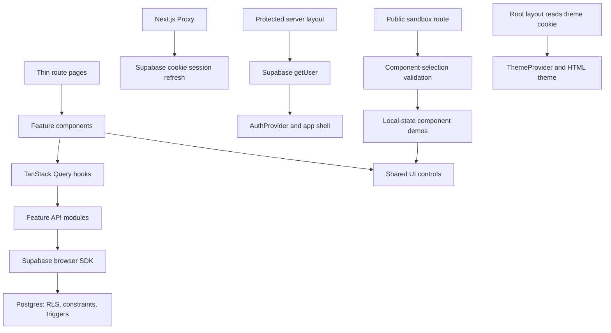

# Project Overview

This is a reusable Fullstack Starter built with Next.js App Router, strict TypeScript, React,
Supabase SSR authentication, TanStack Query, React Hook Form, Zod, Tailwind CSS, Lucide, and
Beautiful UI with unstyled Base UI controls. It includes email/password authentication,
confirmation retry, a protected dashboard, private per-user project CRUD, and a public sandbox
with 81 component demos. The landing page contains one centered button linking to `/sandbox`.
AI, attachment storage, application search/filtering, and realtime remain optional.

## Repository Structure

- `.github/`: GitHub Actions validation and issue/pull-request templates.
- `docs/`: Team workflow/prompts and design references under `docs/design/`.
- `PRD.md`: Product requirements, MVP scope, ownership, and open decisions.
- `DESIGN.md`: Product visual decisions using the existing shared UI.
- `BACKLOG.md`: Canonical tickets, dependencies, acceptance criteria, and implementation prompts.
- `scripts/`: The live two-user Supabase isolation check, `check-rls.mjs`.
- `src/`: Application routes, feature modules, reusable UI, providers, utilities, and types.
- `src/app/`: Thin App Router pages, auth callback, layouts, error states, and app CSS.
- `src/app/(auth)/`: Public login and registration routes.
- `src/app/(dashboard)/`: Protected dashboard, project list, and project-detail routes.
- `src/app/sandbox/`: Only `page.tsx`; sandbox behavior belongs in its feature.
- `src/features/`: Auth, projects, and sandbox, organized into purpose-specific subfolders.
- `src/components/ui/`: One flat reusable component library, CSS tokens, catalog, and MIT notice.
- `src/components/layout/`: The authenticated application shell.
- `src/providers/`: Query cache, authenticated-user lifecycle, and persistent theme providers.
- `src/lib/`: Shared Supabase/Axios clients and theme, upload, calendar, table, and chart helpers.
- `src/types/`: Bootstrapped Supabase database types.
- `src/proxy.ts`: Cookie-based Supabase session refresh for matched application routes.
- `supabase/`: Local service configuration, timestamped SQL migrations, and seed file.
- `tests/`: Node contract, utility, theme, catalog, and component-rendering tests.
- Root configuration: `package.json`, `pnpm-lock.yaml`, `.nvmrc`, TypeScript, ESLint, and Next.js.
- `.env.example`: Public Supabase configuration and optional disposable test-account variables.

## Build & Development Commands

Use pnpm 10.13.1 from `packageManager`; never use npm or Yarn. `.nvmrc` selects Node 22;
`package.json` requires Node `>=22.18 <25`. Keep dependency versions pinned.

Initial setup:

```sh
nvm use
pnpm install
pnpm run dev
```

Reproducible installs with the existing lockfile:

```sh
pnpm install --frozen-lockfile
```

The landing page and `http://localhost:3000/sandbox` need no Supabase configuration.
For authentication and projects, copy the example and fill in the public development credentials:

```sh
cp .env.example .env.local
```

Required checks:

```sh
pnpm run typecheck
pnpm run lint
pnpm test
pnpm run build
```

Run the production build locally:

```sh
pnpm start
```

Debug server-side development code with the installed Next.js inspector option:

```sh
pnpm exec next dev --inspect 127.0.0.1:9229
```

Keep the inspector local. If the environment blocks Turbopack, the previously verified webpack
build command is:

```sh
pnpm run build --webpack
```

Database commands require Supabase CLI; local services also require Docker.
Confirm the target environment before migrations, resets, or live isolation tests.

```sh
# Disposable local database
supabase start
supabase db reset

# Generate local database types
pnpm run db:types

# Generate types from an already linked development project
supabase gen types typescript --linked > src/types/database.ts

# Two different disposable, confirmed users configured in .env.local
pnpm run test:rls
```

The setup guide describes importing the repository into Vercel, choosing Node 22, configuring public
Supabase variables and Auth URLs, and applying reviewed migrations to the intended database.

> TODO: Define the deployment owner, automated deploy command, and preview/production workflow.
> No deploy script or deployment workflow is configured.

## Code Style & Conventions

- Use strict TypeScript, ES modules, and React function components.
- Match nearby formatting: two-space indentation, double quotes, and semicolons.
- ESLint extends Next.js `core-web-vitals` and `typescript` through `eslint.config.mjs`.
- No repository formatter configuration is present; avoid unrelated formatting changes.
- Use kebab-case filenames, PascalCase components/types, and camelCase functions/variables.
- Use `@/` for application imports from `src/`; preserve explicit `.ts` imports in Node tests.
- Group every feature file under `components/`, `hooks/`, `api/`, `validations/`,
  `constants/`, or `types/`, creating only the folders needed.
- Keep feature roots free of loose files; import modules directly without compatibility re-exports.
- Keep route pages thin. Sandbox catalogs and validation stay under `src/features/sandbox/`.
- Reuse helpers and controls before adding implementations or dependencies.
- Use React Hook Form for forms and Zod at both form and feature API boundaries.
- Document deliberate limitations as `shortcut: <limit>, <when to upgrade>`.

UI conventions:

- Keep reusable controls together in `src/components/ui/`; do not create a separate library folder.
- Follow Beautiful UI's visual language with Base UI behavior and Lucide icons; do not add shadcn.
- Apply accepted product layouts and styling from DESIGN.md through the existing UI and token files.
  An intentional change to a documented visual convention must be explicit and aligned here first.
- Use normal Inter. Tokens and catalog CSS live in `src/components/ui/globals.css`;
  app aliases and matching styles live in `src/app/globals.css`.
- Use the shared Button: `rounded-control`, neutral default background, 6 px gap,
  32 px medium height, 12.5 px medium text, and 0.98 press scale.
- Button sizes are `xs/sm/md/lg` at 24/28/32/40 px; preserve disabled and loading behavior.
- Keep `primary/secondary/ghost/danger/quiet` variants and the semantic destructive Button.
- Use neutral primary colors for normal actions and highlights; do not restore accent palettes,
  per-button colors, accent/success Button variants, or pill-shaped shared buttons.
- For button-like navigation, use Button with `nativeButton={false}`, `role="link"`, and
  `render={<Link href="…" />}`; do not nest buttons and anchors.
- Keep inline text links, navigation rows, and linked cards in their own link presentation.
- Toasts use neutral surfaces, status icons, and subtle type tints without colored borders.
- Preserve accessible labels, errors, focus, keyboard navigation, and reduced-motion behavior.

> TODO: Define a commit-message template and whether Conventional Commits are required.
> No commit-message enforcement is configured.

## Architecture Notes



Ordinary application data follows component → TanStack Query hook → feature API module →
shared Supabase SDK. Authentication forms use the auth API directly; the auth provider owns
session lifecycle subscriptions. No CRUD Route Handlers, Server Actions, or separate backend
are needed.

The protected layout verifies the user with `getUser`. Proxy refreshes cookie sessions and
calls `getClaims`. Database RLS is the ownership boundary; redirects and UI visibility
do not authorize access.

Project ownership defaults to `auth.uid()`. Constraints validate fields, and a trigger maintains
timestamps and prevents changes to ownership, ID, and creation time. Update/delete APIs reject
zero affected rows; unknown and inaccessible projects share an unavailable state.

Query keys are `['projects', userId]` and `['project', userId, projectId]`. Create invalidates
lists; update invalidates lists/detail; delete removes detail and invalidates lists. Account
changes and logout clear private cached data. Queries use a 30-second stale time and one default
retry; mutations do not automatically retry.

The sandbox is public and uses sample state rather than private records or fake authentication.
Its SidebarNav shows one alphabetical, searchable catalog. Only the selected demo mounts.
Invalid or repeated component query parameters default to Buttons. The dialog reuses ProjectForm
with a sample submit callback.

Theme changes persist a year-long, site-wide `theme` cookie. The root layout validates that cookie
and applies the theme during server rendering. Preserve this to avoid light-mode flashes.
Navigation and sandbox reset must keep the saved theme; portaled overlays inherit it.

External-service extensions use the shared Axios client → authenticated Route Handler →
server-only implementation. The client has a 15-second timeout; no external-service endpoint
is currently implemented.

## Testing Strategy

1. Run `pnpm run typecheck`, `pnpm run lint`, `pnpm test`, and `pnpm run build`.
2. Add a small meaningful test for new nontrivial logic; trivial and documentation edits need none.
3. For ownership/schema changes, run `pnpm run test:rls` against a confirmed disposable environment.
4. For UI changes, check both themes, keyboard behavior, focus return, reduced motion, and 360 px.
5. Report actual results and skipped checks; do not treat historical verification as current proof.

`pnpm test` uses Node's built-in test runner, assertions, and experimental TypeScript stripping.
The suite covers schema validation, safe return URLs, user-scoped cache keys, theme cookies,
chart/calendar/table/upload helpers, catalog completeness, and control semantics.
Rendering tests transpile real JSX in memory with TypeScript and use React server rendering;
they do not prove browser interactions.

The live RLS script uses two Supabase users, checks isolation and constraints, and attempts
cleanup. Configure the six variables listed in `.env.example`. Never run it against production.

GitHub Actions runs on pushes to `main` and pull requests. It uses Node from `.nvmrc`,
pnpm setup, lockfile-aware installation, typecheck, lint, tests, and the default production build.
It does not run live RLS or browser tests.

> TODO: Choose an e2e runner and configure disposable infrastructure for browser/integration CI.
> No Playwright, Cypress, or automated browser suite is configured.

## Security & Compliance

- Keep passwords, tokens, service-role keys, and other secrets out of source, logs, and commits.
- Store local credentials in ignored `.env.local`; keep `.env.example` free of real values.
- `NEXT_PUBLIC_SUPABASE_URL` and `NEXT_PUBLIC_SUPABASE_PUBLISHABLE_KEY` are public browser config.
  Never place privileged credentials in `NEXT_PUBLIC_*` variables.
- Mark secret or privileged modules `server-only`; shared validations/types must not import them.
- Verify sensitive server operations independently with `getUser` or `getClaims`.
- Do not authorize from `getSession`, client-supplied ownership, redirects, or hidden controls.
- Preserve RLS, constraints, owner-derived inserts, and zero-row mutation checks.
- Retain input on failed submissions and prevent duplicate mutations or false success feedback.
- Restrict auth return destinations with the existing `safeReturnPath` validator.
- Preserve PKCE/token-hash confirmation, cookie refresh, and safe unavailable/error states.
- Upload controls provide selection and presentation only; trusted storage boundaries must
  independently validate files before accepting them.
- Google Fonts is requested by the Inter CSS import.

Review dependency advisories with:

```sh
pnpm audit
```

Do not run `pnpm audit --fix` automatically or upgrade unrelated packages.

> TODO: Define dependency/secret-scanning CI, vulnerability triage, and applicable privacy rules.
> No automated scanning workflow or documented compliance program is present.

Beautiful UI source retains the MIT notice, copyright © 2026 Shane Levine, in
`src/components/ui/LICENSE`. Preserve the notice in copies and substantial adaptations.

> TODO: Choose the repository-wide license; no root license file is present.

## Agent Guardrails

- Follow the current user request and higher-priority instructions.
- For product work, read PRD.md, DESIGN.md, BACKLOG.md, and the assigned ticket before editing.
  PRD owns behavior, DESIGN owns presentation, this file owns implementation conventions, and
  BACKLOG owns task scope/prompts. Identify conflicts instead of silently selecting a rule.
- Templates/TODOs are not product decisions. Do not implement an unresolved requirement or
  invent missing behavior to mark a ticket Ready; continue independent authorized work.
- Keep complete, specific implementation prompts inside each Ready BACKLOG.md ticket.
  Use one owner, branch, and PR per ticket; do not merge or expand scope without authorization.
- Coordinate shared-file changes and use separate checkouts/worktrees for concurrent agents.
  Product/design changes update the source document and affected prompts before implementation.
- Read this file and any applicable nested `AGENTS.md` before editing; deeper instructions
  specialize their directory's conventions within those higher-priority instructions.
- Inspect callers, tests, configuration, and affected contracts; use `rg` for searches.
- Make the smallest complete change and preserve unrelated user edits.
- Use pnpm and the existing lockfile; never create npm/Yarn lockfiles or silently change tooling.
- Do not hand-edit generated `next-env.d.ts`, database types, build output, or dependency contents.
  Regenerate `src/types/database.ts` through the documented command after schema changes.
- Do not edit SQL migrations already applied to shared environments; add timestamped migrations.
- Never overwrite real environment files, expose secrets, or remove license attribution.
- Confirm database targets before writes; use disposable data and clean up test records.
- Keep auth/dashboard/projects unless their removal is explicitly requested.
- Preserve the centered landing button and pages without shared branded headers.
- Keep all sandbox demos public and available; do not add customization pages, accent/radius
  controls, workspace previews, instructional design panels, or private data connections.
- Preserve upload queue capacity checks and object-URL cleanup; DataTable processes supplied
  rows locally while application filters belong in the feature data layer.
- Complete the required checks for runtime/dependency changes and state any restrictions.
- Do not deploy, publish, or modify production infrastructure without task authorization.

The PR template requests validation evidence, ownership checks where relevant, configuration
changes, and known limitations.

> TODO: Define reviewer ownership and approval requirements for auth, schema, and deployment changes.
> No CODEOWNERS file or branch-protection policy is available in the repository.

> TODO: Specify quotas and rate limits before implementing AI or other paid external services.
> No application rate limiter or quota implementation currently exists.

## Extensibility Hooks

- Add features under `src/features/<feature>/` using the category folders and existing data path.
- Add reusable controls under `src/components/ui/` and provide a working sandbox demo.
- Sandbox catalog data lives under `src/features/sandbox/constants/`; selection validation
  lives under `validations/` and demos under `components/`.
- Imported catalog entries and demos live in `src/components/ui/meta.ts` and `registry.tsx`.
- Adapt shared colors, radii, and typography through the existing CSS token files.
- Use `src/lib/axios.ts` for future external Route Handler integrations.
- Add database schema changes through migrations and regenerate database row types.
- AI, attachment storage, search/filtering, and realtime require explicit feature scope;
  local Supabase storage is currently disabled.
- Configure `NEXT_PUBLIC_SUPABASE_URL` and `NEXT_PUBLIC_SUPABASE_PUBLISHABLE_KEY` before building
  authenticated deployments.
- Live isolation tests additionally use `RLS_TEST_USER_A_EMAIL`, `RLS_TEST_USER_A_PASSWORD`,
  `RLS_TEST_USER_B_EMAIL`, and `RLS_TEST_USER_B_PASSWORD`.
- No runtime feature-flag framework or plugin loader is implemented.

> TODO: Document additional environment variables and feature flags when an extension needs them.

## Further Reading

- [Product requirements](PRD.md)
- [Product design](DESIGN.md)
- [Canonical backlog and ticket format](BACKLOG.md)
- [Team workflow and planning/review prompts](docs/team-workflow.md)
- [Step-by-step product and team workflow](README.md)
- [Setup, Supabase confirmation, and deployment](docs/setup.md)
- [Scripts and dependency versions](package.json)
- [CI checks](.github/workflows/ci.yml)
- [Pull-request template](.github/PULL_REQUEST_TEMPLATE.md)
- [Feature issue template](.github/ISSUE_TEMPLATE/feature.md)
- [Project ownership migration](supabase/migrations/20261011000000_projects.sql)
- [Local Supabase configuration](supabase/config.toml)
- [Database isolation script](scripts/check-rls.mjs)
- [Sandbox selection validation](src/features/sandbox/validations/component.ts)
- [Beautiful UI license](src/components/ui/LICENSE)
- [Design reference index](docs/design/design-list.md)
- [Attio design reference](docs/design/attio.com-DESIGN.md)
- [Lemon Squeezy design reference](docs/design/lemonsqueezy-DESIGN.md)

> TODO: Add ADRs when durable architecture decisions need a separate record.

Documentation creation does not verify live authentication, database isolation, or deployment.
Browser, infrastructure, and dependency-audit checks must be run and reported for the relevant task.

